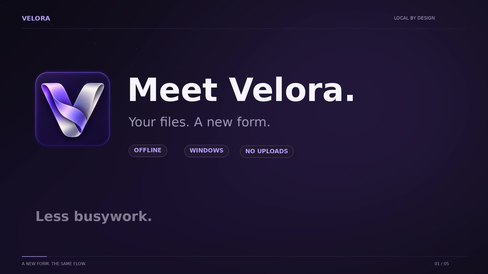
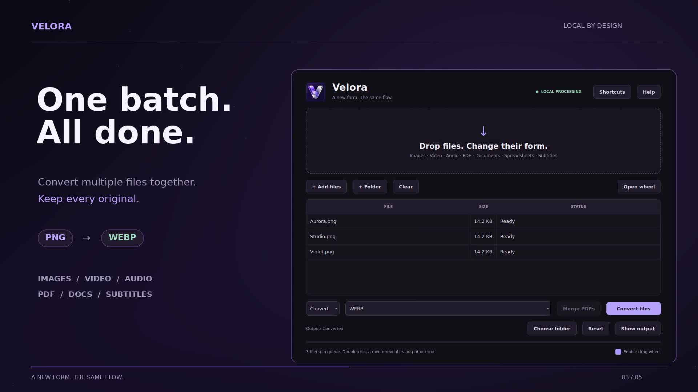

# Velora

**Your files. A new form. — A new form. The same flow.**

Velora is a Windows desktop tool for converting files and handling everyday file edits in one interface. Its promotional video presents a local processing workflow that keeps your files on your device instead of uploading them to an online conversion service.

> The walkthrough below describes the promotional video. The Windows package has been inspected and repacked to remove unused files. The repacked application has not been run on Windows in this session; see the [portable guide](docs/PORTABLE.md) for verification details.

## Watch the demo

**[Watch or download the full video](docs/media/Velora-Promo-Shortcuts-18s.mp4)** · MP4 · 18 seconds · 1920 × 1080

Click the image or link to open the video file on GitHub. If a player is unavailable, use the file download button.

## Download

**Windows x64 portable ZIP prepared (105 MB).** Release asset upload is pending; no public binary download is available yet. The included application documentation targets Windows 10 / 11 x64.

Extract the entire ZIP, then open **Velora.exe**. Keep `runtime/`, `velora/`, `main.py`, and the other accompanying files together. Python, Qt, conversion libraries and FFmpeg are bundled. Office-to-PDF conversion requires LibreOffice installed separately.

When published, the ZIP and SHA-256 checksum will be available on the [releases page](https://github.com/Soiltary/Velora/releases). See the [portable application guide](docs/PORTABLE.md) for supported formats and limitations.

## Features at a glance

| Area | Shown in the demo |
| --- | --- |
| File conversion | Images, video, audio, PDFs, documents, spreadsheets, and subtitles |
| Batch conversion | Add and convert multiple files together; the demo describes preserving originals |
| Conversion wheel | Choose an output format from a visual wheel, accessible with `Ctrl + Space` |
| PDF tools | Split, merge, and extract text |
| Image tools | Resize, rotate, and compress |
| Media tools | Trim media and extract audio |
| Processing | Local processing, as described in the demo |

The demo shows a batch of PNG images being converted to WEBP. The image wheel also displays PNG, JPG, WEBP, AVIF, TIFF, BMP, ICO, and PDF. A format appearing in the wheel does not mean every input can be converted to it; use the options the application offers for your selected file.

## Get started on Windows

To start the portable application:

1. Obtain the Windows x64 ZIP once the release assets are published.
2. Extract the entire archive into its own folder before running it. Keep the accompanying files together with the application.
3. Open **Velora.exe**. Read `START_HERE.txt` and the included `README.md` for instructions. Office-to-PDF conversion requires LibreOffice.
4. Start with a sample file and inspect the output before processing a larger batch.

The included guide targets Windows 10 / 11 x64 and identifies the launcher as unsigned. Minimum memory requirements have not been documented.

## Convert files step by step

1. Drag files into **Drop files. Change their form.**, or click **+ Add files**. Use **+ Folder** to add a folder.
2. Review the file list and each file's status in the table.
3. Select an operation from **Convert**, then choose an available output format.
4. Click **Choose folder** to select where the results will be saved.
5. Click **Convert files** and wait for processing to finish.
6. Click **Show output** to open and review the results.

The interface also includes **Clear** to empty the list and **Reset** to reset settings. Its status text says you can double-click a file's row to reveal its output or error.

## Conversion wheel and shortcuts

- Click **Open wheel**, or use **Ctrl + Space**, as shown in the demo.
- The demo shows selecting a file and dropping it onto the desired format in the wheel.
- An **Enable drag wheel** option is visible in the interface.
- Open **Shortcuts** for the shortcuts available in your version, and **Help** for additional guidance.

## PDF, image, and media tools

The demo presents PDF splitting, merging, and text extraction; image resizing, rotation, and compression; and media trimming and audio extraction. Select the relevant operation in your version, choose the input files and output folder, and inspect the results. A **Merge PDFs** button is visible in the main interface. Detailed settings and limitations for these operations have not yet been verified.

## Privacy

The demo emphasizes **Local processing / Offline / No uploads**, describing conversion on your device. This is the product description shown in the video, rather than the result of a source code or network audit. The package source was inspected during repacking; no network audit was performed.

## Troubleshooting

- **The format you want is missing:** Check the input file type and the formats offered by your installed version.
- **A conversion fails:** Review the file status and error message. Try a small, known-good input and an output folder you can write to.
- **You cannot find the results:** Click **Show output** and check the destination selected with **Choose folder**.
- **The shortcut does not work:** Try **Open wheel**, check **Shortcuts**, and look for shortcut conflicts with other applications.
- **The application does not start:** Make sure the full package has been extracted on Windows x64, then include the error text in an issue report. Check the included portable guide for requirements and limitations.

## Support and links

- [Velora repository](https://github.com/Soiltary/Velora)
- [Releases](https://github.com/Soiltary/Velora/releases)
- [Issue tracker](https://github.com/Soiltary/Velora/issues)
- [Promotional video](docs/media/Velora-Promo-Shortcuts-18s.mp4)

When reporting a problem, include your Windows version, Velora version, input file type, steps to reproduce, and error message. Avoid sharing private files. If Issues is disabled, use the contact method provided by the repository owner.

## Repository contents and verification status

This repository includes the English guide, promotional media, application source, build inputs, tests, and license notices. A smaller portable Windows package has been prepared; its GitHub Release remains a draft until asset upload is completed. Unused development assets, caches, temporary files, duplicate libraries and Qt modules were removed; retained executable files are unchanged. Static dependency checks and ZIP integrity checks passed. Windows desktop behavior has not been tested in this session.

Velora source is licensed under GNU AGPL v3 or later; see [LICENSE.txt](LICENSE.txt). Bundled components retain their own licenses; see [THIRD_PARTY_NOTICES.md](THIRD_PARTY_NOTICES.md).
